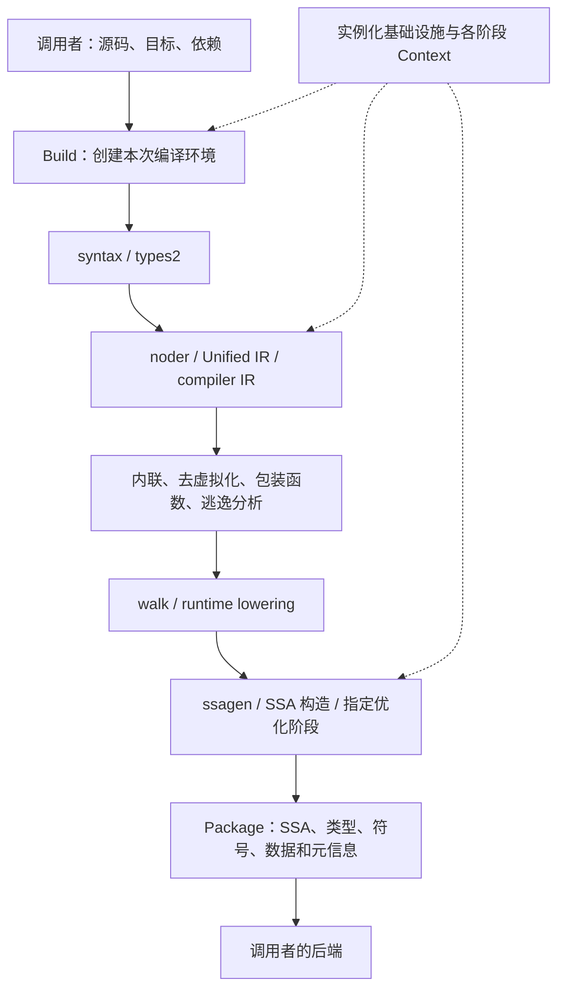

# 整体设计

状态：已实现源码级 Build/Compile、双架构后端和隔离工具链替换。验收结果与边界见 [最终验收](m7-qualification.md)。

## 目标与范围

输入 Go 1.27 包源码及显式依赖，复用官方编译器前端和指定 SSA 优化阶段，在当前进程内返回可供自定义后端使用的 Go SSA 结构。

并列目标：完成后可替换官方 Go 1.27 编译器中的对应实现，通过适配继续连接原生后端并完成工具链构建。使用同一套库实现，详见 [原生编译器回接](go-compiler-integration.md)。

源码解析之前的模块下载、构建标签选择、cgo 预处理由调用方或未来独立 loader 完成。核心库不调用外部编译器，也不从宿主 GOROOT 偷取内部包。cgo 预处理和外部汇编由原生构建工具负责，库接收其源码与 SymABIs；cgo、race、PGO 及汇编协作已分别验证。MSan/ASan、完整覆盖率驱动和未验收实验组合不在当前公开支持范围。替换驱动拒绝未接入选项，不静默忽略。

只维护一套 Go 1.27 移植实现。当前 pin 为官方 go1.27.1；不引入多 Go 版本兼容框架。GoALLC 可提供经验和差分验证，但不是默认移植源。

## 确定的架构



“无状态”指公共调用之间不依赖共享可变编译状态。单次编译内部有显式状态；输出对象由结果持有。只读常量表可以共享，但 map、slice、指针指向的对象也必须审计其传递可变性。

## 分层与代码归属

| 层 | 责任 | 代码来源 |
| --- | --- | --- |
| 公共入口 | Request 校验、取消、错误、结果所有权 | 本库维护 |
| 基础设施 | 目标布局、类型环境、符号、位置、诊断、数据记录 | 本库维护边界，可移植上游内部实现 |
| 编译阶段 | 解析、检查、IR、优化、walk、SSA 算法 | 上游抽取与结构改写 |
| 阶段适配 | Context、依赖注入、生命周期、入口和终止阶段 | 本库维护 |
| 移植工具 | 精确抽取、重写、生成、审计、差异报告 | 本库维护 |

“库维护基础设施”不要求重写 Go 类型系统、布局算法或 AST。优先保留上游数据结构和算法，由本库拥有构造、状态、API 和版本承诺。具体声明只能有一个维护者，不能人工文件与生成文件重复定义。

## 目标目录

```text
compiler/                            源码 Build/Compile、Request、Package、Artifact
ssa/ types/ ir/ ssagen/ gcbridge/    公开图、类型与原生后端元数据接口
position/ target/ diagnostic/       公开位置、布局与结构化诊断
amd64/ arm64/                       公开目标后端安装入口
internal/
  syntax/ types2/ noder/ ir/         保留 src/cmd/compile/ 以下结构
  types/ typecheck/ inline/
  devirtualize/ escape/ walk/
  ssa/ ssagen/ abi/ gc/ ...         移植算法与同包 adapter_*.go
  cmd/objabi/ cmd/obj/ cmd/src/ ...  src/cmd/internal/ 辅助包
  go/abi/ go/buildcfg/ go/pkgbits/   src/internal/ 辅助包
  gcintegration/                    隔离原生驱动、vendor 和 bootstrap 适配
  port/                             移植工具；rules.go 定义版本与规则
cmd/syncgo/                         inspect/generate/check 命令
cmd/gcintegrate/                    创建隔离替换工具链源码树
sync/generated.json                生成文件与源码哈希账本
third_party/go/                     上游 LICENSE/PATENTS
```

编译器源码以 `src/cmd/compile/` 为相对根，直接映射到项目根。例如 `src/cmd/compile/internal/types/pkg.go` 对应 `internal/types/pkg.go`。不增加版本目录或 `upstream/src/cmd/compile/` 前缀，也不按抽取功能重命名上游包。辅助依赖分别放在 `internal/cmd/` 和 `internal/go/`，避免编译器 `abi` 与 Go 内部 `abi` 等包发生冲突；各自根以下结构保持不变。

上图包含后续目标包；当前已移植位置模块、前端位置/字符读取器以及 types/ir/objabi 的算法切片，详见 [M2 记录](m2.md)。保留目录不代表整个包已移植。原生命令入口和 gc 驱动按实际职责选择，不因路径映射而整目录复制。

生成文件保留上游文件名，由文件头和 `sync/generated.json` 标记归属；同包手写文件统一使用 `adapter_*.go`，例如 `internal/types/adapter_context.go`。同包适配可访问私有成员；共享基础设施可放独立包。工具拒绝与上游同名的 adapter，不能人工修改生成文件或同步覆盖手写文件。新增本库独立包时也要检查上游命名冲突。

公开 `ssa/`、`types/` 等包以别名和必要访问接口暴露内部对象，算法和对象定义保持唯一来源。根入口和公开包均能合法导入本 module 的 `internal/`；外部后端通过公开接口使用，不需要导入内部包。私有成员访问通过同包 adapter 补充，不能依靠别名突破可见性。

## 依赖方向

底层设施不导入顶层 frontend。各阶段只接收自己需要的状态或窄接口；frontend 负责创建实例、连接回调。不能创建一个包含全部阶段类型的公共 Context，再让每个包反向依赖它。

类型、符号、IR 相互引用仍可能形成环。保留上游已有的解环方式，并在桥接处使用窄接口、稳定 ID 或调用方提供的函数。具体环在 M1/M2 的依赖图中逐个处理，不使用全局 service locator。

调用者直接取得本库 SSA 对象，不要求生成第二种序列化 IR。公共 SSA 采用上游相近的结构，但公共字段可达的类型必须同样可由外部调用者使用：不能让后端必须 import 本库 internal 才能解读 Aux。

原生回接使用版本绑定的 gcbridge；对象身份、私有字段/方法和 native tail 的衔接在接口设计时一起审计。独立 Build 仍不默认执行原生机器码阶段。

## 版本与兼容

- 语言版本：固定 Go 1.27。
- 源码版本：`internal/port/rules.go` 中的精确 upstream commit。
- 构建工具链：首轮实现和 CI 使用官方 Go 1.27.1；后续工具链兼容另行验证。
- 本库 API：实现阶段 v0，可随设计演进；不承诺原始上游字段跨版本稳定。
- 依赖 artifact：记录前端 revision、目标、语言、实验配置和格式版本，严格校验。

每次升级先在 Go 1.27 系列内演练。能重新编译不等于升级完成，还需要状态审计与语义差分验证。

## 最重要的工程风险

| 风险 | 应对 |
| --- | --- |
| Context 参数传播修改大量调用点 | 少量符号规则批量改写，特殊回调显式适配 |
| 类型/符号暗含缓存和目标布局 | 每次调用独立 Universe，禁止跨调用复用可变图 |
| 构造 SSA 仍含 Go runtime/ABI 假设 | 明确输出阶段与后端契约，逐项验证 |
| 移植范围逐渐扩展成整个工具链 | 按声明与依赖闭包区分编译语义和命令行/代码输出设施 |
| 过早重写类型系统导致移植规则膨胀 | 复用上游实现，优先改所有权与环境边界 |
| 框架开发完仍无法运行编译 | M3 起建立源码到 SSA 的纵向闭环，并提前演练升级 |

详细验收与尚待细化事项见 [实施路线](roadmap.md)。
